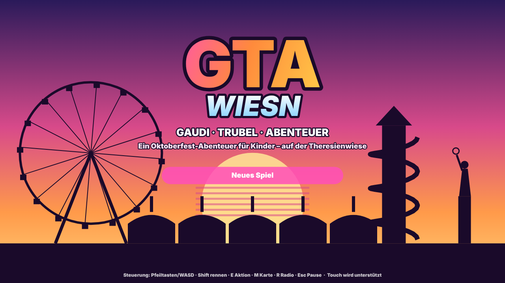
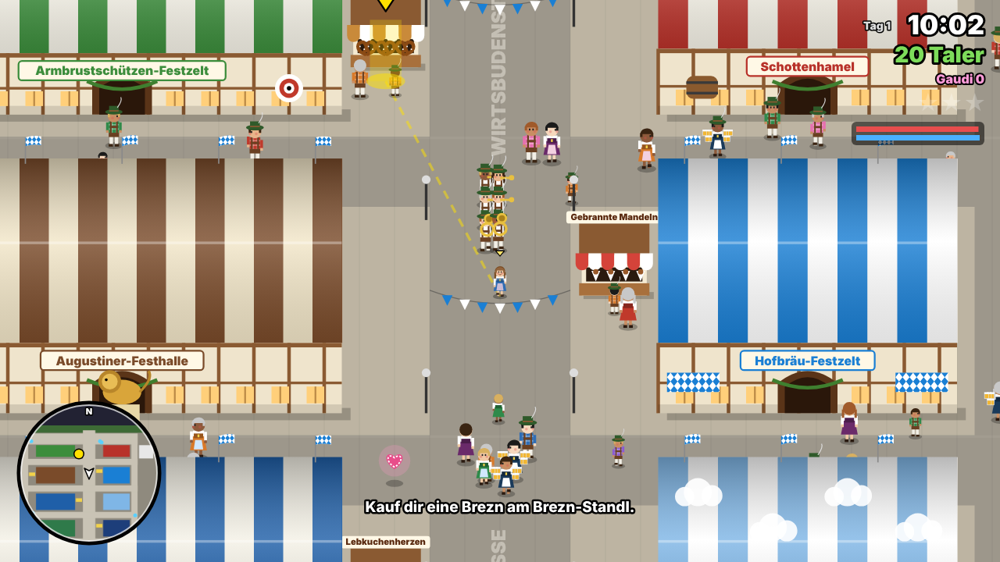
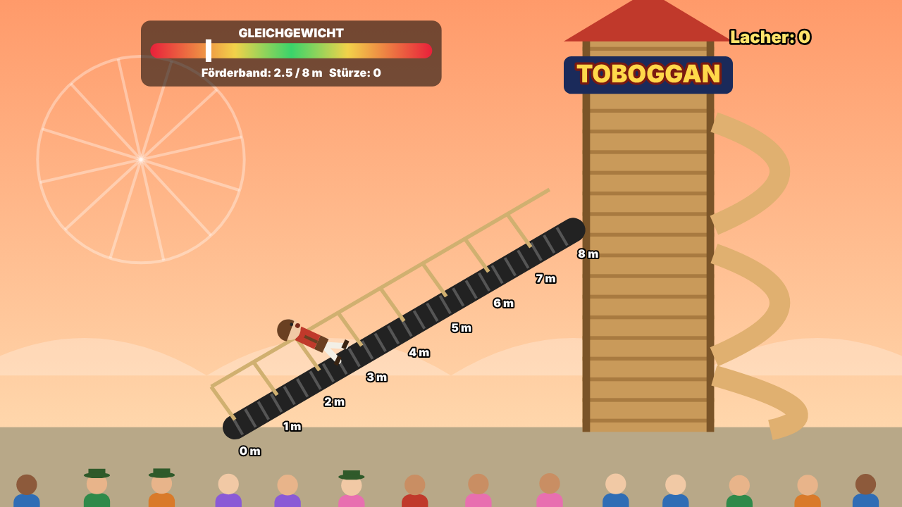
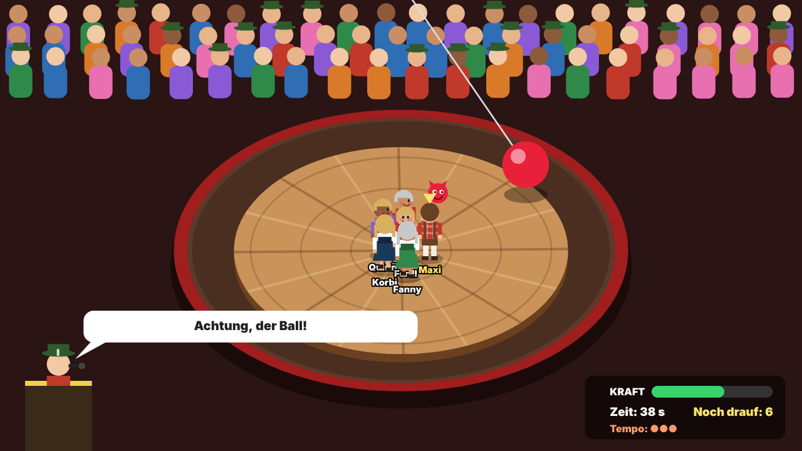
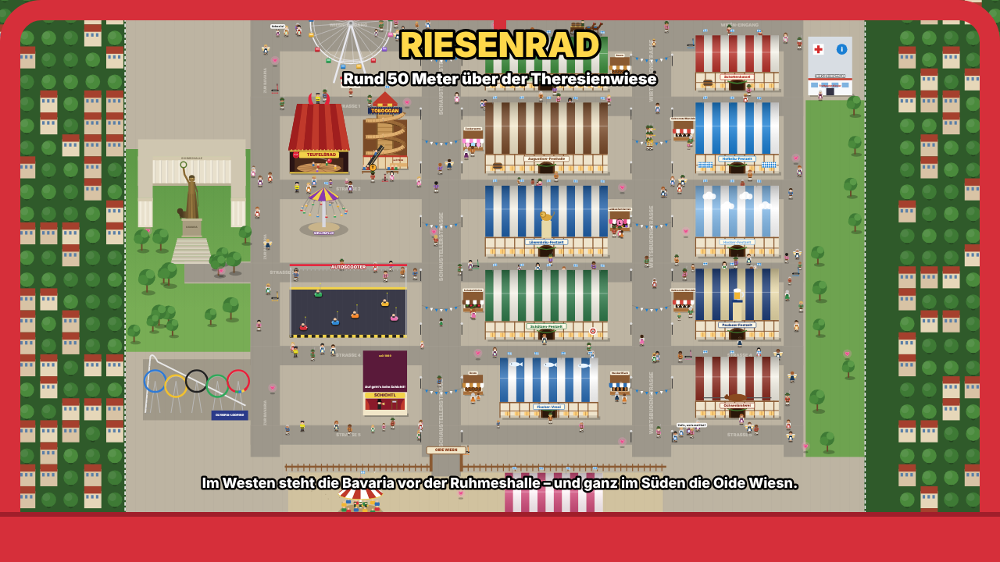
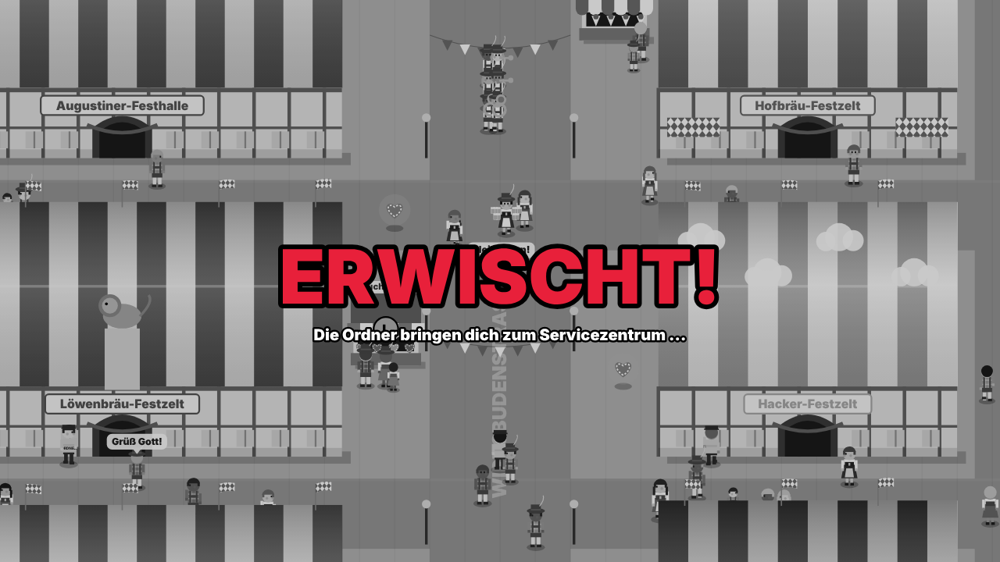
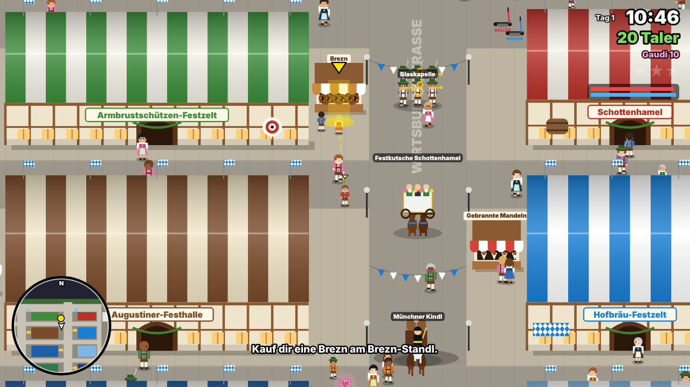
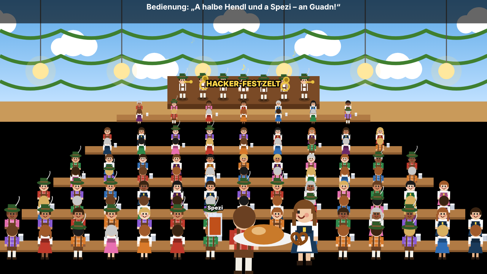
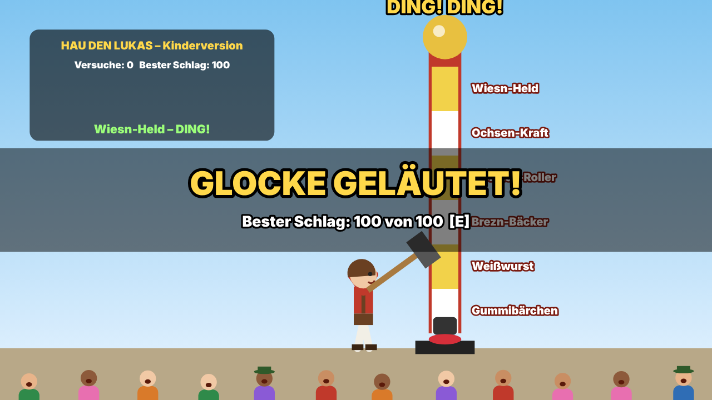
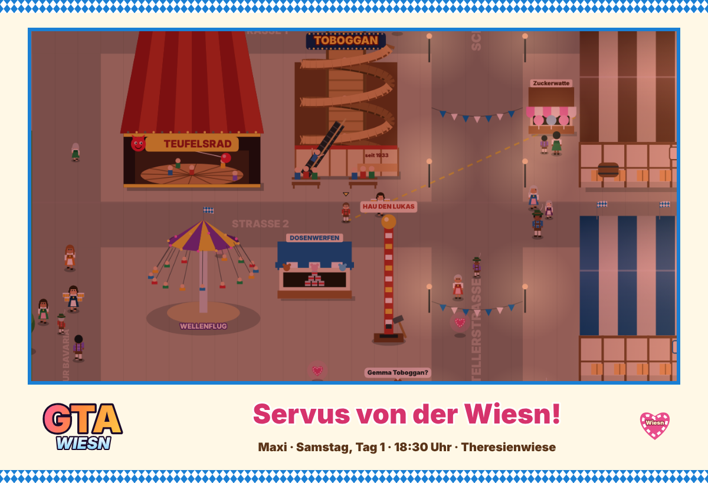

# GTA Wiesn – Gaudi, Trubel, Abenteuer

Ein kinderfreundliches Browserspiel „im Stil von GTA“, das als **geschlossene Welt** auf der
Münchner Theresienwiese während des Oktoberfests spielt. Statt Autoklau und Verfolgungsjagden
gibt es Roller, Ordner, verlorene Dackel, Lebkuchenherzen – und die zwei großen Klassiker der
Wiesn: den **Toboggan** und das **Teufelsrad**.

## Starten

`index.html` im Browser öffnen, fertig. Es braucht keinen Server, keine Installation und kein
Internet. Musik, Geräusche und alle Grafiken erzeugt das Spiel selbst (Canvas + WebAudio).

Läuft am Rechner mit Tastatur und auf Tablet/Handy mit Touch-Steuerung (virtueller Joystick).

## Steuerung

| Taste | Funktion |
|---|---|
| Pfeiltasten / WASD | laufen, Roller fahren |
| Shift | rennen (kostet Puste) |
| E / Enter | reden, kaufen, aufsteigen, Fahrgeschäfte |
| M | Lageplan der Theresienwiese |
| R | Radiosender wechseln (Blasmusik!) |
| Esc / P | Pause mit Missionen, Wiesn-Wissen und Optionen |

## Was steckt drin

**GTA-Elemente, kindgerecht übersetzt**
- Missionen mit Buchstaben-Symbolen auf der Minikarte, Missions-Titelkarten, „MISSION GESCHAFFT!“
- Fahrzeuge: Roller-Stationen, Autoscooter, Pferdegespann der Brauerei als Verkehr
- Fahndungssterne → **Ordner-Sterne**: Wer wild herumrempelt, wird von Ordnern verfolgt.
  Statt „WASTED/BUSTED“ heißt es **„ERWISCHT!“** – und man landet beim Servicezentrum hinter
  dem Schottenhamel (der echte Treffpunkt für verlorene Kinder).
- Radiosender mit prozedural erzeugter Blasmusik (Polka, Walzer, Marsch)
- Tag-Nacht-Wechsel mit Vice-City-Sonnenuntergang; um 20 Uhr endet der Tag
  (echte Wiesn-Regel für Kinder unter 16)
- Sammelobjekte: 18 versteckte Lebkuchenherzen schalten „Wiesn-Wissen“ frei

**Die Missionen**
1. *Servus, Wiesn!* – Oma Resi, die erste Brezn, der erste Roller
2. *Der Toboggan* – Förderband-Balance (8 m), Wendeltreppe, Holzrutsche; Rivale Ferdl
3. *Das Teufelsrad* – Fliehkraft-Physik (inkl. Corioliskraft) auf der drehenden Scheibe,
   Ball am Seil, Lasso des Rekommandeurs
4. *Lebkuchen-Kurier* – drei Herzen in drei Minuten ausliefern
5. *Waldi ist weg!* – Dackel-Verfolgungsjagd
6. *Die Meisterrunde* – Teufelsrad für Profis, danach Riesenradfahrt in den Sonnenuntergang

**Nebenaufgaben und Ereignisse**
- *Ferdls Roller-Rennen* – Checkpoint-Rennen einmal rund um die Wiesn (Mission „V“)
- **Einzug der Wiesnwirte** am ersten Tag ab 10:35 Uhr: Münchner Kindl vorneweg, Festkutsche,
  Prachtgespanne und Blaskapellen ziehen über die Wirtsbudenstraße
- **O’zapft is!** um 12 Uhr – mit zwölf Böllerschüssen als Signal an alle Zelte
- Zufallsereignisse: ein **verlorenes Kind** zum Servicezentrum bringen, einen davonfliegenden
  **Luftballon** fangen
- Radio-Moderator mit Wiesn-Meldungen, Böllerschießen am letzten Wiesn-Tag (Tag 16)
- **Festzelt-Innenansicht** bei der Brotzeit: Blaskapelle auf dem Podium, schunkelnde Gäste,
  im Hacker-Zelt der „Himmel der Bayern“, im Hofbräu-Zelt blau-weiß
- **Minispiele:** Hau den Lukas (Kinderversion), Dosenwerfen (Gewinn: ein Teddy zum Mitnehmen),
  Schiffschaukel mit Bremsbrett
- **Oide Wiesn:** Krinoline, Schiffschaukel, Kettenflieger Kalb von 1919, Museumszelt mit Velodrom
- **18 Erfolge** (Pokale) und eine **Wiesn-Postkarte**: Im Pausenmenü ein Foto der aktuellen Szene
  als PNG-Postkarte speichern

Außerdem: Riesenrad (Blick über das ganze Gelände), Bavaria (Aussicht aus dem Kopf),
Wellenflug, Krinoline mit Live-Blaskapelle, Schichtl-Show mit Guillotine-Zaubertrick,
Autoscooter, Olympia-Looping („du bist noch zu klein“), Buden mit Brezn, gebrannten Mandeln,
Zuckerwatte, Schokofrüchten, Steckerlfisch und Lebkuchenherzen; Brotzeit in den Festzelten.

Wer im Teufelsrad runterfliegt, bekommt bei jedem neuen Versuch etwas leichtere Gegner.
Am Toboggan wird nach zwei Stürzen das Krabbeln freigeschaltet, nach dem dritten hält dich ein Helfer an der Hand – wie die echten Toboggan-Helfer. So bleibt es für Kinder schaffbar.

## Recherche (Auswahl)

Die Wiesn-Fakten im Spiel stammen aus diesen Quellen:

- Toboggan: [muenchen.de](https://www.muenchen.de/veranstaltungen/oktoberfest/fahrgeschaefte/toboggan),
  [oktoberfest.de](https://www.oktoberfest.de/attraktionen/fahrgeschaefte/der-toboggan),
  [muenchen.travel – die schönsten Wiesn-Geschichten](https://www.muenchen.travel/artikel/maerkte-feste/oktoberfest/die-schoensten-wiesn-geschichten)
  (seit 1933 auf der Wiesn, 8 m Förderband, Name aus der Algonkin-Sprache, früher 10 m höher mit zwei Rutschen, 1908 drei Turmrutschen)
- Teufelsrad: [muenchen.de](https://www.muenchen.de/veranstaltungen/oktoberfest/fahrgeschaefte/teufelsrad),
  [oktoberfest.de](https://www.oktoberfest.de/attraktionen/fahrgeschaefte/feldls-teufelsrad),
  [oktoberfest-guide.com](https://oktoberfest-guide.com/attractions/teufelsrad/)
  (Carl Gabriel 1908, Familie Feldl, Rekommandeur, Ball am Seil und Lasso, Karl Valentin als Fan)
- Lageplan und Straßen: [muenchen.de – Übersichtsplan](https://www.muenchen.de/veranstaltungen/oktoberfest/oktoberfest-muenchen-uebersichtsplan),
  [muenchenwiki – Wirtsbudenstraße](https://www.muenchenwiki.de/wiki/Wirtsbudenstra%C3%9Fe)
- Kinder und Familie: [oktoberfest.de – Wiesnbesuch mit Kindern](https://www.oktoberfest.de/informationen/kinder-und-familie/infos-fuer-den-wiesnbesuch-mit-kindern)
  (20-Uhr-Regel, Treffpunkt Servicezentrum hinter dem Schottenhamel, Familientage)
- Programm: [muenchen.de – Wiesn-Programm](https://www.muenchen.de/veranstaltungen/oktoberfest/programm-termine)
  (Einzug der Wiesnwirte, Böllerschießen an der Bavaria)
- Anstich und Böller: [oktoberfest.de – Eröffnung und Anstich](https://www.oktoberfest.de/informationen/termine/eroeffnung-und-anstich-des-oktoberfests)
  (zwölf Böllerschüsse vor der Bavaria als Signal an die Zelte)
- Einzug der Wiesnwirte: [muenchen.de – Wirteeinzug](https://www.muenchen.de/veranstaltungen/oktoberfest/einzug-der-wiesnwirte)
  (Münchner Kindl vorneweg, OB in der Festkutsche der Familie Schottenhamel, sechs Brauereien mit Prachtgespannen)
- Oide Wiesn: [oktoberfest.de – Die Oide Wiesn](https://www.oktoberfest.de/bierzelte/die-oide-wiesn),
  [muenchen.de – Tradition und Nostalgie](https://www.muenchen.de/veranstaltungen/oktoberfest/oide-wiesn-das-historische-oktoberfest)
  (Kettenflieger Kalb von 1919, Schiffschaukel, Museumszelt mit Velodrom-Nachbau)
- Hau den Lukas: [oktoberfest.de – Hau den Lukas](https://www.oktoberfest.de/attraktionen/standl/hau-den-lukas)
- Toboggan-Details (Kokosmatten, Helfer): [oktoberfest.de – Der Toboggan](https://www.oktoberfest.de/attraktionen/fahrgeschaefte/der-toboggan)
- Olympia-Looping: [Wikipedia](https://en.wikipedia.org/wiki/Olympia_Looping) (fünf Loopings, ca. 1.250 m, seit 1989)
- Klassiker und Schmankerl: [muenchen.travel – Das Oktoberfest von O bis T](https://www.muenchen.travel/artikel/maerkte-feste/oktoberfest/das-oktoberfest-von-o-bis-t)
  (Krinoline, Schichtl seit 1869 und Guillotine seit 1872, Steckerlfisch, Lebkuchenherzen)

Der Lageplan im Spiel ist vereinfacht und an die echte Anordnung angelehnt. Alle Figuren sind
erfunden. Das Projekt ist eine private Hommage und hat nichts mit Rockstar Games oder den
genannten Festwirten zu tun.

## Dateien

```
wiesn/
├── index.html
└── js/
    ├── util.js       Hilfsfunktionen, Zeichen-Helfer (Rautenmuster, Text im GTA-Stil)
    ├── audio.js      prozedurale Blasmusik, Geräusche, deutsche Sprachausgabe
    ├── input.js      Tastatur, Maus, Touch-Joystick
    ├── world.js      Theresienwiese: Zelte, Buden, Fahrgeschäfte, Kollision, Wegenetz
    ├── entities.js   Besucher, Bedienungen, Blaskapelle, Pferdegespann, Roller, Dackel
    ├── minigames.js  Toboggan, Teufelsrad, Schichtl-Show
    ├── missions.js   Story-Missionen und Wiesn-Wissen
    ├── extras.js     Oide Wiesn, Hau den Lukas, Dosenwerfen, Schiffschaukel, Festzelt,
    │                 Einzug der Wiesnwirte, Zufallsereignisse, Roller-Rennen, Erfolge
    ├── ui.js         HUD, Minikarte, Dialoge, Lageplan, Pausenmenü, Touch-Knöpfe
    └── main.js       Szenen, Spieler, Kamera, Ordner, Tageszeit, Speichern
```

## Screenshots

| | |
|---|---|
|  |  |
|  |  |
|  |  |
|  |  |
|  |  |
